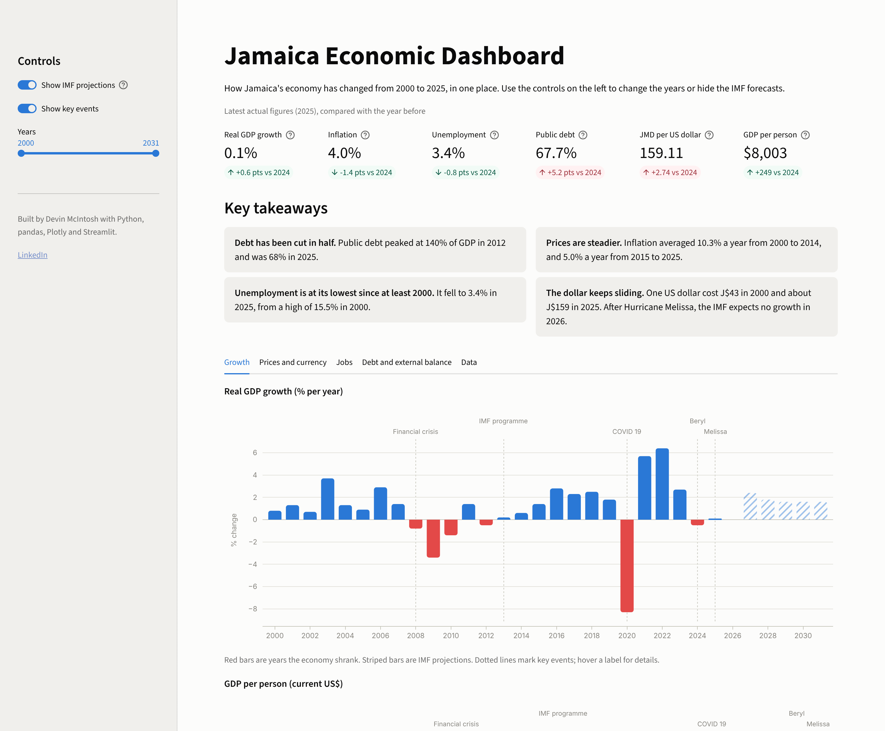

# Jamaica Economic Dashboard

How Jamaica's economy has changed since 2000, from the debt crisis years to the 2025 hurricane, in one interactive dashboard built with Python, pandas, Plotly and Streamlit.

**Live app: https://jamaica-economy.streamlit.app**



## The short version

| | |
|---|---|
| Years covered | 2000 to 2025, with IMF projections to 2031 |
| Public debt | 140.3% of GDP at its 2012 peak, 62.5% in 2024, 67.7% in 2025 |
| Unemployment | 15.5% in 2000, 3.4% in 2025, the lowest in the series |
| Real growth | about 1.0% a year on average, 28% in total over 26 years |
| Exchange rate | 43 JMD per USD in 2000, 159 in 2025 |
| Indicators | 9, from the IMF, the World Bank and the Penn World Table |

## Four findings

**1. Jamaica more than halved its debt burden.** Public debt peaked at 140.3% of GDP in 2012. After the 2013 IMF programme it fell almost every year, to 62.5% in 2024. Hurricane Melissa pushed it back up to 67.7% in 2025.

**2. Growth has been the weak spot the whole time.** Real GDP grew about 1.0% a year on average from 2000 to 2025, which adds up to only 28% over 26 years. The economy shrank in 2008 to 2010, fell 8.3% in 2020 during COVID 19, and was flat again in 2024 and 2025 after two hurricanes.

**3. The job market turned around.** Unemployment was 15.3% as late as 2013. By 2025 it was 3.4%, the lowest in the data.

**4. The external gap closed.** The current account deficit reached 19.8% of GDP in 2008. Since 2021 it has been close to balance or in surplus. Over the same period the Jamaican dollar lost about 73% of its value against the US dollar, from 43 to 159 per dollar.

## What it shows

* Headline numbers for the latest year: growth, inflation, unemployment, public debt, the exchange rate and GDP per person
* Key takeaways written from the data, so they update when the data does
* Charts for growth, prices and the exchange rate, jobs, debt and the current account
* IMF projections to 2031, shown as dashed lines and striped bars, which you can switch off
* Key events marked on every chart: the 2008 financial crisis, the 2013 IMF programme, COVID 19, Hurricane Beryl (2024) and Hurricane Melissa (2025)
* A data table with a CSV download

## Data sources

| Indicator | Source |
| --- | --- |
| Real GDP growth, unemployment, public debt, current account | IMF World Economic Outlook (DataMapper API) |
| Inflation, GDP, GDP per person, population | World Bank World Development Indicators, via FRED |
| Exchange rate (JMD per USD) | Penn World Table via FRED to 2023; 2024 and 2025 are averages of daily market rates |

All data sits in `data/jamaica_indicators.csv` in long format (indicator, year, value, is_projection, source).

## Run it on your computer

```bash
pip install -r requirements.txt
streamlit run app.py
```

## Refresh the data

```bash
python update_data.py
```

This pulls the latest figures from the IMF and FRED and merges them into the CSV. Each year, move `first_projection_year` forward by one at the bottom of the script.

## Project structure

```
app.py                     the dashboard
update_data.py             data refresh script (IMF + FRED)
data/jamaica_indicators.csv
requirements.txt
screenshot.png
.streamlit/config.toml     theme
```

Built by [Devin McIntosh](https://www.linkedin.com/in/devinlerandezmcintosh).
